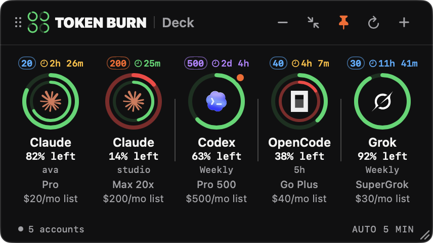
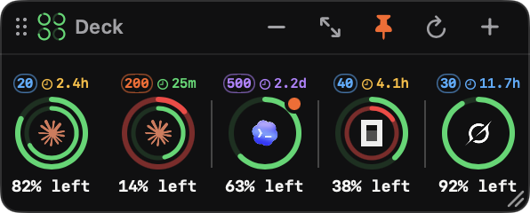
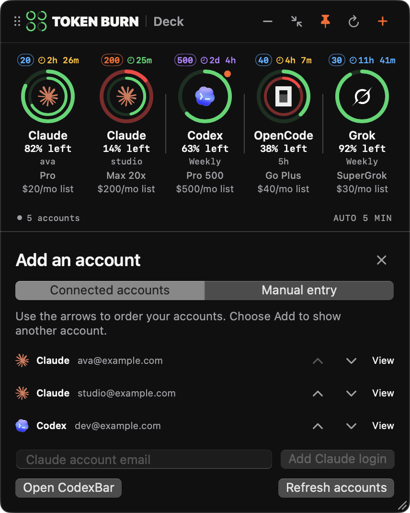
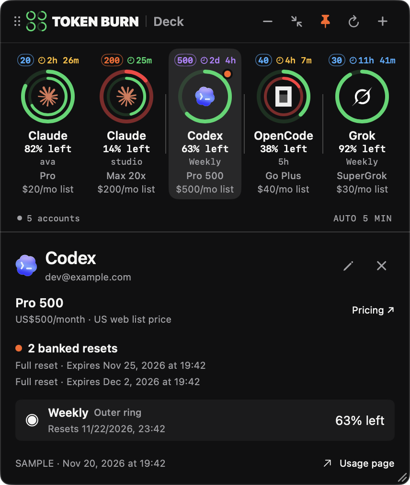

# Token Burn

Token Burn is a macOS app for tracking AI subscriptions. Its main view, the **Deck**, keeps your accounts visible across desktops. Each ring shows the percentage of allowance left for Claude, Codex, OpenCode Go or Grok. A companion Deck runs on [Windows and Linux](#windows-and-linux).



The screenshots use fictional accounts and example usage. Ava’s Claude Pro account has 82% of its session allowance left. The studio’s Max 20x account has 14%, so its outer ring is red.

## Install on macOS

Token Burn targets macOS 14 or later. To install this source release, follow the build instructions below. If you have a packaged DMG for your Mac’s architecture, open it and drag **Token Burn.app** onto **Applications**. A locally built `dist/Token Burn.app` can also be copied directly. The Deck appears on your desktop, and its green rings appear in the menu bar.

### Build from source

Install current Xcode Command Line Tools with `xcode-select --install` if needed. Once the installation finishes, run these commands from the project folder.

```sh
./build.sh
open "dist/Token Burn.app"
```

The script builds an app for your Mac’s architecture and signs it locally. You can move the resulting app into Applications.

### Package the app and Homebrew cask

Run `./package.sh` to build a DMG with an Applications shortcut and a checksum-pinned cask in `dist/Casks/token-burn.rb`. The default cask reads the DMG beside the tap’s `Casks/` directory. Its architecture and minimum macOS requirements match the packaged app.

For a hosted GitHub release, pass the real project URL to `./package.sh https://github.com/ai-armageddon/token-burn`. Upload the **same generated DMG** to that repository’s `v<version>` release and put the generated Ruby file in the tap’s `Casks/` directory. Once published, users can install with `brew install --cask OWNER/TAP/token-burn`. Homebrew installs CodexBar as a cask dependency and places Token Burn in Applications by default. The build script signs locally; a public notarized binary release requires Developer ID signing and notarization.

### Get live readings

Open Token Burn. If CodexBar is missing, **Set up live tracking** offers **Install CodexBar** on Macs with Homebrew. Otherwise, **Download CodexBar** opens its official release page. Move CodexBar to Applications and the Deck detects it. Completing first-run setup opens Connected accounts. **Later** keeps manual entries available, and the refresh arrow reopens setup. [CodexBar installation](https://github.com/steipete/CodexBar#install)

Open **+ → Connected accounts** to add accounts. For Claude, enter the account email and choose **Add Claude login**. Token Burn prompts for Claude Code if needed, then starts Claude’s browser authorization. For Codex, OpenCode Go, and Grok, sign in with the provider or configure the account in CodexBar, then use **Refresh accounts** and **Add** in Token Burn. **Manual entry** works for all four providers.

## Windows and Linux

The `desktop/` folder holds a companion Deck for Windows and Linux. It is built with Tauri and uses the same rings, tiles, account order, pricing and reset rules as the Mac app. It reads usage the same way, through the CodexBar CLI.

- **Linux.** Install the CodexBar CLI with `brew install steipete/tap/codexbar`, from the AUR (`codexbar-cli`), or from a Linux release tarball. Token Burn finds it in `~/.local/bin`, Homebrew's Linux prefix, `/usr/local/bin` or your `PATH`. If Homebrew is present, **Install CodexBar** runs it for you. The tray icon needs an AppIndicator-capable desktop; on GNOME, that means the AppIndicator extension. Without a tray, use the window's own buttons.
- **Windows.** CodexBar has no native Windows CLI, so Token Burn runs it inside WSL. Run `wsl --install`, then install the CodexBar Linux CLI, and Claude Code if you use **Add Claude login**, inside your default WSL distribution. Separate Claude logins keep their profiles in the WSL home folder under `~/.local/share/token-burn`.
- Browser-cookie and Keychain sources are macOS-only in CodexBar. On Linux and WSL, configure Codex, OpenCode Go and Grok logins with OAuth, an API key, or a manual cookie in the CodexBar CLI config. Claude Desktop accounts are not available. **Manual entry** works everywhere.
- Settings and cached readings are saved in `accounts.json`, in `~/.local/share/app.tokenburn.deck/` on Linux and `%APPDATA%\app.tokenburn.deck\` on Windows.

### Build the companion

Install Node.js 20 or later and Rust, plus the [Tauri prerequisites](https://v2.tauri.app/start/prerequisites/) for your system. On Debian or Ubuntu, those are `libwebkit2gtk-4.1-dev libxdo-dev libssl-dev libayatana-appindicator3-dev librsvg2-dev`. Then run these commands.

```sh
cd desktop
npm ci
npm test
npx tauri build
```

Linux produces `.deb`, `.rpm` and AppImage packages; Windows produces NSIS and MSI installers. They appear under `desktop/src-tauri/target/release/bundle/`. The **Windows and Linux Deck** GitHub workflow builds both on each change to `desktop/`. `npm run dev` opens a browser preview with the fictional sample accounts; add `?setup` or `?windows&setup` to the URL to see first-run setup.

## Using the Deck

The outer ring shows the selected allowance window. An inner ring shows a second window when available. Green means at least 20% remains, red means less than 20%, and gray means the balance is unknown.

Drag the dotted grip or title to move the panel. Drag the bottom-right grip to make the widget smaller or larger. Its scale is saved across launches. The diagonal arrows switch between full and compact layouts. Click the minus button to minimize, then choose **Restore Deck** from its menu-bar icon. The pin keeps it above other windows. The green usage rings in the menu bar open the Deck controls.



## Accounts and readings

<details>
<summary>See the sample accounts and their reset details</summary>

The connected-account list distinguishes `ava@example.com` and `studio@example.com` even though both use Claude.



The orange dot on Codex marks two banked resets. Opening the tile shows when each one expires.



</details>

- Hover over a ring for a summary. Click it for the account, plan, usage windows, reset times and last update. Select a window to display its remaining percentage on the ring. An orange dot means the account has banked resets. Hover or expand for the count and reported expirations. Claude may report only the next expiry. An isolated Claude login tries a matching OAuth reading first, then falls back to the CLI. The CLI reports quotas without a saved-reset count. When a web or OAuth reading omits the inventory, the Deck shows “not reported” in the tooltip and details.
- Drag an account tile onto another tile to move it into that position. A click opens details. With multiple pages, drop on a page arrow to move across the page boundary. The arrows in **+ → Connected accounts** also change the order. Each account keeps its position across refreshes and restarts.
- Each tile shows its numeric price in a colored corner badge when a single price is known. The clock beside the badge counts down to the outer ring’s reset and updates every minute. Green means within an hour, amber within six hours, blue within a day and purple beyond a day. A dash means the provider did not supply a reset time. A past reset shows “due” until a new reading arrives. Hover for the exact local reset time, currency, billing period and price source.
- To add a separate Claude login, enter the email in **+ → Connected accounts → Add Claude login** and finish the Claude browser authorization. Each login uses its own Claude Code profile. Token Burn checks the email before displaying its allowances.
- Full-size rings display the account tier and price. Compact rings include them on hover. A price marked **list** is the published US monthly web rate for a recognized tier. The pencil lets you enter your billed price with its currency and interval, or supply a missing tier. Clearing a field restores automatic display.
- Click the pencil to name the account. Click **+** to see connected accounts, add discovered accounts or bring back hidden rings, or add a manual account with a label, remaining percentage and optional reset.
- To show a distinct Claude Desktop login, use **+ → Connected accounts → Add**. If it says **Connect**, open its details and click **Connect Claude Desktop** to authorize CodexBar in macOS Keychain.
- For additional automatic accounts, add the provider login to CodexBar where the provider supports multiple accounts, then click **Refresh accounts**. Only one account per provider appears by default. Use **Add** to show any additional discovered account. Token Burn discovers the named accounts returned by `codexbar usage --provider … --all-accounts` and falls back to the active login when no token accounts are configured. The provider's own dashboard opens in your default browser, using that browser's signed-in account.
- Automatic readings refresh at launch and every five minutes while the app is running. OpenCode tracks the Go subscription. A local estimate is marked **Est.** on the ring. For account-wide OpenCode Go readings, configure the Go API key in CodexBar.
- A failed refresh preserves the last reading and shows its age in details. An unreported allowance shows a dash. Manual readings keep their entered value after the reset until you update them.
- Settings, labels and cached readings are saved in `~/Library/Application Support/Token Burn/accounts.json`. Provider authentication is handled by CodexBar.

Run `./test.sh` to check account reconciliation and usage decoding.

[CodexBar CLI and account setup](https://github.com/steipete/CodexBar/blob/main/docs/cli.md)

Provider marks come from CodexBar and OpenCode. [Third-party notices](Resources/ThirdPartyNotices.txt)
